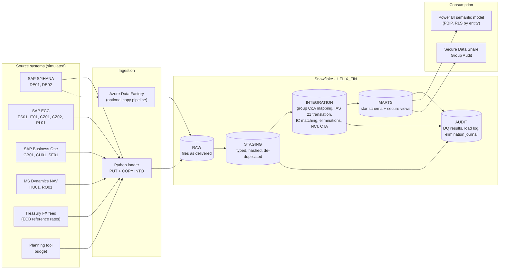
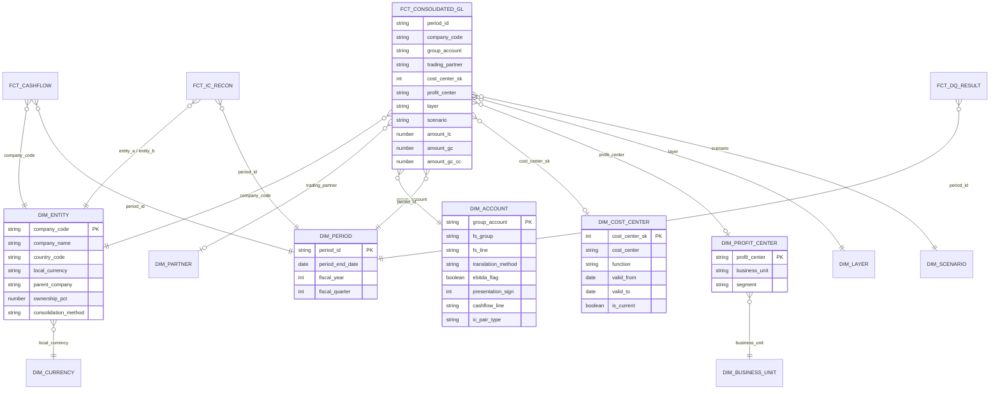

# Pharma Group Financial Consolidation & Management Reporting Platform


An end-to-end finance BI platform that consolidates a multinational pharmaceutical group in
**Snowflake** and serves **statutory (IFRS)** and **management (business-unit)** reporting from one
governed **Power BI** semantic model. It covers multi-currency translation, intercompany
eliminations, non-controlling interests, consolidated cash flow and an automated data-quality layer.

> **Helix Pharma Group is fictional.** All data is synthetic and generated by the code in
> [`generator/`](generator/). Any resemblance to a real company is coincidental.

---

## Executive summary

| | |
|---|---|
| **Problem** | 12 legal entities send Excel trial balances from 4 different ERPs in 8 currencies. Intercompany balances never net to zero, statutory and management EBITDA can't be reconciled, and month-end close takes 8+ working days. |
| **Solution** | A layered Snowflake ELT pipeline (RAW → STAGING → INTEGRATION → MARTS) that maps local accounts to a 120-account group chart, translates under IAS 21, matches and eliminates intercompany flows, books NCI and CTA, and blocks bad data with 12 automated rules. |
| **Outcome** | One consolidation walk from local books to group figures, statutory vs adjusted EBITDA on one page, constant-currency growth, an IC reconciliation cockpit, and a close-status dashboard that shows which entity is blocking the close and why. |

---

## Table of contents
1. [Business problem](#1-business-problem)
2. [Solution architecture](#2-solution-architecture)
3. [Consolidation logic](#3-consolidation-logic)
4. [Data model (star schema with SAP FI/CO dimensions)](#4-data-model-star-schema-with-sap-fico-dimensions)
5. [Data-quality framework](#5-data-quality-framework)
6. [Synthetic data design](#6-synthetic-data-design)
7. [Repository structure](#7-repository-structure)
8. [How to run](#8-how-to-run)
9. [Results](#9-results)
10. [Design decisions & simplifications](#10-design-decisions--simplifications)
11. [Skills demonstrated](#11-skills-demonstrated)

---

## 1. Business problem

Helix Pharma Group (HQ Berlin) develops, manufactures and sells prescription medicines (Rx), OTC
products, medical devices and herbal preparations across Europe.

| Pain point | Impact |
|---|---|
| Each entity submits a trial balance (TB) in its **own local chart of accounts** (SKR04, PGC, PCG, BAS …) | Group Controlling remaps about 1,300 local accounts by hand every month |
| **Intercompany** flows (goods from the German plant, contract manufacturing in Czechia, management fees, loans, dividends) are booked at different times and rates | IC differences are found late, after the auditors ask |
| **8 currencies** (EUR, CZK, PLN, HUF, RON, GBP, CHF, SEK) | No constant-currency view: management can't separate real growth from FX |
| **Statutory** (legal entity, IFRS) and **management** (business unit, adjusted) reporting come from different spreadsheets | Two EBITDA figures that nobody can reconcile |
| No systematic **data-quality** checks | Errors such as unbalanced TBs, missing FX rates and wrong partner codes surface in the board pack |

**Goal:** a single governed platform that produces both views from the same data, with a
complete audit trail from every source file to every reported number.

---

## 2. Solution architecture



**Orchestration.** STAGING and INTEGRATION are **views** (the logic lives in SQL that can be read
top to bottom). `MARTS.SP_REFRESH()` materialises the heavy integration steps and all mart tables with
`INSERT OVERWRITE`, which keeps grants and row access policies, and `AUDIT.SP_RUN_DQ()` evaluates the
12 rules. A stream on `RAW.TB_LINES` drives a **task DAG**:

```
T_DETECT_NEW_TB (every 15 min, only WHEN the stream has data)  →  T_REFRESH_MARTS  →  T_RUN_DQ
```

**Close control.** A **blocking** finding marks the entity-period, and the group for that period,
as `BLOCKED`: the period cannot be released. Data is still processed, but unmapped and unbalanced
amounts are parked on suspense account `9900` and invalid IC lines are not eliminated, so the impact
is visible instead of silently dropped. Warnings are reported without blocking.

| Layer | Schema | Responsibility |
|---|---|---|
| Landing | `RAW` | Files exactly as delivered (`COPY INTO` from an internal stage), load metadata, source manifest |
| Cleansing | `STAGING` | Data types, trimming, `SHA2` row hash, de-duplication with `QUALIFY ROW_NUMBER()` |
| Business logic | `INTEGRATION` | Local → group account mapping, IAS 21 translation, CTA, IC matching, elimination journal, NCI |
| Presentation | `MARTS` | Conformed dimensions, fact tables, secure views for sharing |
| Governance | `AUDIT` | `dq_results`, `load_log`, exception lists, close status |

**Security.** Roles `FIN_ENGINEER`, `GROUP_CONTROLLER` and `COUNTRY_CONTROLLER`. A Snowflake
**row access policy** restricts country controllers to their entities, mirrored by Power BI RLS.

---

## 3. Consolidation logic

### 3.1 Currency translation (IAS 21, functional currency → EUR)

| Item | Rate | `translation_method` |
|---|---|---|
| Balance-sheet balances (assets, liabilities) | Closing rate of the period | `CLOSING` |
| P&L monthly movements (YTD = sum of months) | Average rate of the month | `AVG` |
| Share capital, capital reserve, pre-migration retained earnings | Historical rate (`fx_historical.csv`) | `HISTORICAL` |
| Dividends distributed | Average rate of the month booked | `HISTORICAL_TXN` |
| Prior fiscal years' results | Sum of the translated P&L of those years | `CARRYFORWARD` |
| **Currency translation reserve (CTA)** | Plug that keeps the translated TB at zero, booked to account `3900` (OCI) | `CONSOLIDATION` |

All IC invoices are issued in EUR. Non-EUR entities revalue their EUR-denominated IC balances at
the closing rate each month (FX result in account `7300`), so receivables and payables match after
translation, as they would in a real group.

A **constant-currency** amount (actuals translated at the budget rate) is computed next to every
translated amount, so the FX effect = actual at actual rates − actual at budget rates.

### 3.2 Intercompany matching & eliminations

| Pair type | Side A (seller / creditor) | Side B (buyer / debtor) | Elimination |
|---|---|---|---|
| `SALES_COGS` | `4100` IC sales | `5010` IC purchases | Dr IC sales / Cr IC purchases |
| `MGMT_FEE` | `4300` IC service revenue | `6800` IC management fees | Dr revenue / Cr expense |
| `INTEREST` | `7010` IC interest income | `7210` IC interest expense | Dr income / Cr expense |
| `DIVIDEND` | `7100` dividend income (DE01) | `3300` dividends distributed | Dr dividend income / Cr retained earnings |
| `AR_AP` | `1190` IC receivables | `2090` IC payables | Dr payable / Cr receivable |
| `LOAN` | `1400` loans to group | `2200` loans from group | Dr loan payable / Cr loan receivable |

* **Matching key:** period × side-A entity × side-B entity × pair type, using the SAP trading-partner
  field (`VBUND`) on every IC line.
* **Elimination:** both sides are reversed; the net of each pair and period is booked to the IC
  difference accounts `9100` (P&L) / `9110` (balance sheet), so every elimination journal nets to zero
  (rule DQ09). P&L pairs are compared on movements, balance-sheet pairs on cumulative balances.
* **Tolerance:** pairs that differ by more than EUR 1,000 or 0.5 % become **exceptions** in the IC
  cockpit (rule DQ08). Lines with an invalid partner code are reported (DQ07) and not eliminated.
* **Unrealised profit in inventory (UPI):** closing balance of `1340` (goods bought from DE02),
  translated at the closing rate × DE02 margin on sales (15 % markup → 13.04 %). Dr group COGS /
  Cr inventory; the P&L effect is the change against the prior period.
* **Investment & equity elimination:** DE01 `1800` investment against each subsidiary's
  `3000 + 3100` at historical rate; the difference is **goodwill** (PL01: EUR 8.0m).
* **Non-controlling interests (NCI):** PL01 is 80 % owned. NCI = 20 % of PL01's equity at acquisition
  and of its migrated retained earnings, plus 20 % of each period's profit (account `9300`, *profit
  attributable to NCI*) and of its CTA; the 20 % dividend to the minority shareholder reduces NCI.

### 3.3 Statutory vs management view

Both views come from **one fact table**, using a `layer` dimension:

```
LOCAL → TRANSLATED → IC_ELIM → CONSOL_ADJ (UPI, NCI, goodwill) → MGMT_ADJ → GROUP
```

* **Statutory view:** layers up to `CONSOL_ADJ`, by legal entity (IFRS 10).
* **Management view:** adds `MGMT_ADJ`, where Group Controlling's adjustment file
  (`management_adjustments.csv`) reclassifies non-recurring items to account `9200` to show *adjusted
  EBITDA*. It reports by **business unit and profit centre** (Rx, OTC, Medical Devices, Herbal, Corporate).
* A reconciliation table **Statutory EBITDA → Adjusted EBITDA** proves that both views tie.

### 3.4 Consolidated cash flow (indirect method)

Each balance-sheet account carries a `cashflow_line` (`OP_WC_RECEIVABLES`, `OP_DA_ADDBACK`,
`INV_CAPEX_PPE`, `FIN_DIVIDENDS` …). The cash-flow statement is derived from translated BS movements
plus net income. The **FX effect on cash** is shown separately:
`closing cash @ closing rate − opening cash @ prior closing rate − Σ cash flows @ average rate`.
Rule DQ11 proves that the statement reconciles to the BS cash movement.

---

## 4. Data model (star schema with SAP FI/CO dimensions)



**Grain of `FCT_CONSOLIDATED_GL`:** period × entity × group account × trading partner × cost centre ×
profit centre × layer × scenario (`ACT`, `BUD`). Amounts are stored in local currency (`amount_lc`),
group currency (`amount_gc`) and constant currency at budget rates (`amount_gc_cc`).

| SAP concept | Field in this repo | Notes |
|---|---|---|
| Company code (`BUKRS`) | `company_code` | DE01 … SE01 |
| G/L account (`HKONT`) | `gl_account` (local) → `group_account` | 10 local charts mapped to 120 group accounts |
| Trading partner (`VBUND`) | `trading_partner` | Drives IC matching |
| Cost centre (`KOSTL`) | `cost_center` | **SCD Type 2**: Medical Affairs moves from R&D to S&M on 2024-07-01 |
| Profit centre (`PRCTR`) | `profit_center` | Entity × business unit |
| Period 000 (balance carry-forward) | `fiscal_period = 0` | Opening balance sheet at migration (2023) |

---

## 5. Data-quality framework

Results are written to `AUDIT.DQ_RESULTS` (rule, severity, entity, period, failing rows).
A **BLOCKING** finding sets the close status of the entity-period and of the group period to
`BLOCKED` (`AUDIT.V_CLOSE_STATUS`, also exposed as `MARTS.V_CLOSE_STATUS` for Power BI).

| Rule | Name | Severity | Check |
|---|---|---|---|
| DQ01 | `TB_BALANCED` | BLOCKING | Local trial balance nets to zero per entity and period |
| DQ02 | `ACCOUNT_MAPPED` | BLOCKING | Every local G/L account maps to a group account |
| DQ03 | `FX_COMPLETE` | BLOCKING | Average and closing rate exist for every currency and period |
| DQ04 | `FX_PLAUSIBLE` | WARNING | Rates move less than 10 % versus the prior month |
| DQ05 | `SUBMISSION_COMPLETE` | BLOCKING | All 12 entities delivered a trial balance |
| DQ06 | `NO_DUPLICATES` | WARNING | No exact duplicate rows within a delivery |
| DQ07 | `PARTNER_VALID` | BLOCKING | Trading partner exists and is not the entity itself |
| DQ08 | `IC_MATCHED` | WARNING | IC pairs match within EUR 1,000 or 0.5 % |
| DQ09 | `ELIMINATIONS_BALANCED` | BLOCKING | Elimination journal nets to zero |
| DQ10 | `BS_BALANCED` | BLOCKING | Consolidated assets = liabilities + equity + NCI |
| DQ11 | `CASHFLOW_RECONCILED` | BLOCKING | Cash-flow statement reconciles to BS cash movement |
| DQ12 | `SOURCE_TO_REPORT` | BLOCKING | Loaded rows and amounts match the source manifest |

### Deliberately injected defects (the test of the DQ layer)

[`generator/inject_errors.py`](generator/inject_errors.py) plants 12 realistic defects and writes an
answer key to `data/_expected/injected_errors.csv`. The pytest suite asserts that each one is caught.

| ID | Rule | Entity / period | Defect |
|---|---|---|---|
| E01 | DQ01 | HU01 2024-03 | Amount typo (+12,345.67 HUF): TB does not balance |
| E02 | DQ02 | RO01 2025-02 | New local account `659990` used but never mapped |
| E03 | DQ03 | HUF 2025-11 | Rates missing from the FX feed |
| E04 | DQ04 | SEK 2025-06 | Closing rate keyed 18 % too high |
| E05 | DQ05 | GB01 2025-12 | File not delivered (arrives later in `data/late_arrivals/`) |
| E06 | DQ06 | CZ01 2024-09 | 25 rows delivered twice |
| E07 | DQ07 | IT01 2024-11 | Payable booked with non-existent partner `DE03` |
| E08 | DQ07 | ES01 2025-04 | IC purchases booked with own company as partner |
| E09 | DQ08 | PL01 2024-12 / 2025-01 | Cut-off: December IC purchases booked in January |
| E10 | DQ08 | HU01 2025-03 | Management fee converted at a wrong rate (+3 %) |
| E11 | DQ08 | SE01 2025-06 | Management fee booked by the seller only |
| E12 | DQ12 | ES01 2025-08 | File truncated in transfer (3 rows lost) |

---

## 6. Synthetic data design

| Code | Entity | Country | Ccy | Role | Source ERP |
|---|---|---|---|---|---|
| DE01 | Helix Pharma Holding GmbH | DE | EUR | Parent / holding: management fees, IC loans, receives dividends | SAP S/4HANA |
| DE02 | Helix Pharma Produktion & Vertrieb GmbH | DE | EUR | Factory: sells to all sales companies at cost + 15 %; German market | SAP S/4HANA |
| CZ02 | Helix Manufacturing Brno s.r.o. | CZ | CZK | Contract manufacturer for DE02 at cost + 8 % | SAP ECC |
| ES01 | Helix Pharma Iberia S.L. | ES | EUR | Sales company | SAP ECC |
| IT01 | Helix Pharma Italia S.r.l. | IT | EUR | Sales company | SAP ECC |
| CZ01 | Helix Pharma CZ s.r.o. | CZ | CZK | Sales company | SAP ECC |
| PL01 | Helix Pharma Polska Sp. z o.o. | PL | PLN | Sales company, **80 % owned** (NCI, goodwill EUR 8m) | SAP ECC |
| HU01 | Helix Pharma Hungary Kft. | HU | HUF | Sales company | MS Dynamics NAV |
| RO01 | Helix Pharma Romania S.R.L. | RO | RON | Sales company; IC loan drawn July 2024 | MS Dynamics NAV |
| GB01 | Helix Pharma UK Ltd | GB | GBP | Sales company | SAP Business One |
| CH01 | Helix Pharma Schweiz AG | CH | CHF | Sales company | SAP Business One |
| SE01 | Helix Pharma Nordic AB | SE | SEK | Sales company | SAP Business One |

**How the data is produced.** [`generator/generate_tb.py`](generator/generate_tb.py) is an
event-driven mini-ERP. Every business event is a **balanced journal in integer cents**, so each
trial balance nets to zero by construction. It simulates sales with **seasonality** (OTC cold & flu
peaks), **gross-to-net** deductions (statutory rebates, wholesaler and tender discounts, returns),
IC goods flows with **inventory targets**, production at DE02 with a finished-goods buffer, OPEX by
**cost centre**, CAPEX with **assets under construction** (DE02 packaging line 2024, CZ02 cleanroom
2025), IFRS 16 leases, pensions, bank debt, monthly tax and **dividends** (including the minority
share of PL01).

**Events the budget did not foresee** (so the variance analysis has stories to tell):
* PL01 loses a hospital tender: Rx −15 % in H2 2024
* Strong cold & flu season: OTC +20 % in January and February 2025
* Italian Rx price cut: −5 % from April 2025

**One-off costs** that Group Controlling reclassifies as non-recurring in the management view:
M&A due diligence at DE01 (EUR 1.5m, Nov 2024), tender-stock write-off at PL01 (EUR 0.45m, Sep 2024),
flood repairs at DE02 (EUR 2.2m, Feb 2025) and a legal settlement at IT01 (EUR 0.6m, Jun 2025).

**Budget** (`version = BUD`) uses the same engine without noise, 6 % growth, 3 % OPEX savings and
budget FX rates (prior-December closing rate).

---

## 7. Repository structure

```
pharma-group-consolidation-snowflake/
├── README.md
├── requirements.txt
├── .gitignore
├── .env.example                     # Snowflake connection template (copy to .env)
├── pytest.ini
├── generator/                       # synthetic data (Python)
│   ├── config.py                    # entities, currencies, 120-account CoA, drivers, DQ rule catalogue
│   ├── generate_master_data.py      # entities, CoA, local mappings, cost/profit centres, FX
│   ├── generate_tb.py               # 36 monthly closes, IC sub-ledger, budget
│   ├── inject_errors.py             # 12 data-quality defects + answer key + source manifest
│   └── run_all.py                   # one command: generate, validate, inject, print metrics
├── snowflake/                       # SQL by layer (executed in this order)
│   ├── 00_setup/                    # 01 warehouse, database, schemas · 02 roles & grants · 03 file format, stage
│   ├── 10_raw/                      # 01 landing tables + stream · 02 COPY INTO (17 sources)
│   ├── 20_staging/                  # 01 typed views, SHA2 row hash, de-duplication, latest load per file
│   ├── 30_integration/              # 01 config, period spine, FX gap-filling · 02 mapping & IAS 21 translation
│   │                                # 03 IC matching & eliminations · 04 UPI, investment, goodwill, NCI, mgmt adj.
│   ├── 40_marts/                    # 01 mart logic views · 02 mart tables · 03 MARTS.SP_REFRESH()
│   ├── 50_audit/                    # 01 audit tables · 02 the 12 DQ rules, AUDIT.SP_RUN_DQ(), close status
│   ├── 60_tasks/                    # 01 stream-triggered task DAG
│   └── 70_security_sharing/         # 01 row access policy · 02 secure views · 03 secure share
├── orchestration/
│   ├── run_pipeline.py              # CLI: setup, load, transform, refresh, dq, security, tasks, status, verify, all
│   └── reference_engine.py          # pandas implementation of the same rules (offline tests + reconciliation)
├── tests/
│   ├── test_generator.py            # clean data consistent, deterministic, answer key complete
│   ├── test_reference_engine.py     # consolidation correct; each of the 12 defects detected
│   ├── test_sql_static.py           # SQL lint: objects created before use, RAW columns = CSV headers, seeds
│   ├── test_run_pipeline.py         # SQL statement splitter
│   └── test_snowflake_integration.py# opt-in: same checks against your Snowflake account + RLS + tasks
├── powerbi/                         # (Batch 3) PBIP project, DAX measures, Power Query M, build guide
├── adf/                             # (Batch 3, optional) Azure Data Factory copy pipeline (JSON)
└── data/                            # generated locally (git-ignored)
    ├── master/  fx/                 # reference data and exchange rates
    ├── raw/tb/                      # tb_<company>_<yyyymm>.csv (period 00 = opening balances)
    ├── raw/ic/  raw/budget/         # IC sub-ledger, budget
    ├── raw/adjustments/             # management adjustments (non-recurring items)
    ├── raw/control/                 # source manifest (control totals)
    ├── late_arrivals/               # file delivered after the close deadline
    └── _expected/                   # answer key and summary metrics
```

---

## 8. How to run

### 8.1 Generate the data locally (about 10 seconds)

```bash
git clone https://github.com/mohammedelsayed741996-blip/pharma-group-consolidation-snowflake.git
cd pharma-group-consolidation-snowflake
python -m venv .venv
source .venv/bin/activate            # Windows: .venv\Scripts\activate
pip install -r requirements.txt

python generator/run_all.py --update-readme
```

The run prints a validation report on the clean data (every TB balances, every IC pair matches to
the cent, the IC sub-ledger ties to the ledger), injects the 12 defects, prints the summary metrics
and writes them into the table in [section 9](#9-results). The output is deterministic (fixed seed).

Useful options:

| Option | Effect |
|---|---|
| `--no-errors` | Clean data only (no injected defects) |
| `--seed 123` | A different but equally consistent data set |
| `--ecb-csv path/to/eurofxref-hist.csv` | Use real ECB reference rates instead of simulated ones (download the historical CSV from the ECB website) |
| `--out other/folder` | Write somewhere other than `./data` |

### 8.2 Build the platform in Snowflake

1. **Account.** A Snowflake trial account is enough; everything runs on an `XSMALL` warehouse with
   `AUTO_SUSPEND = 60`.
2. **Credentials.** Copy `.env.example` to `.env` and fill it in. Key-pair authentication is
   recommended for service users.
3. **Run the pipeline** (the `setup` step connects with `SNOWFLAKE_ADMIN_ROLE`, default `ACCOUNTADMIN`;
   all other steps use `FIN_ENGINEER`):
   ```bash
   python orchestration/run_pipeline.py setup        # warehouse, database, schemas, roles, stage, RAW + AUDIT tables
   python orchestration/run_pipeline.py load         # PUT + COPY INTO (17 sources), every file logged in AUDIT.LOAD_LOG
   python orchestration/run_pipeline.py transform    # deploy STAGING, INTEGRATION, MARTS and AUDIT objects
   python orchestration/run_pipeline.py refresh      # CALL MARTS.SP_REFRESH()
   python orchestration/run_pipeline.py dq           # CALL AUDIT.SP_RUN_DQ() + findings by rule
   python orchestration/run_pipeline.py security     # row access policy + secure views (--share: data share)
   python orchestration/run_pipeline.py tasks        # create the task DAG (suspended)
   python orchestration/run_pipeline.py status       # close-status grid: entity x period
   python orchestration/run_pipeline.py verify       # reconcile Snowflake with the reference engine
   # or everything in one go
   python orchestration/run_pipeline.py all
   ```
4. **Late-arrival demo (incremental load).** The first run blocks GB01 2025-12 (rules DQ05 and DQ12).
   Deliver the late file. Either resume the task DAG and let the stream trigger the consolidation:
   ```bash
   python orchestration/run_pipeline.py tasks --resume
   python orchestration/run_pipeline.py load --late      # tasks pick it up within 15 minutes
   ```
   or run the steps yourself: `load --late`, then `refresh`, `dq` and `status`. December is no longer
   blocked by GB01.
5. **Row-level security demo.** `USE ROLE COUNTRY_CONTROLLER; USE SECONDARY ROLES NONE;` then query
   `MARTS.FCT_CONSOLIDATED_GL`: only CZ01, CZ02, PL01, HU01 and RO01 are visible.

### 8.3 Tests

```bash
pytest                                              # 67 offline tests, ~35 s, no Snowflake needed
HELIX_RUN_SNOWFLAKE_TESTS=1 pytest -m snowflake     # after "run_pipeline.py all" (PowerShell: $env:HELIX_RUN_SNOWFLAKE_TESTS=1)
```

The offline suite generates its own data sets, runs the pandas **reference engine** (the same rules as
the SQL) and asserts that every one of the 12 planted defects is detected by the right rule at the
right entity and period, with no unexplained findings. It also lints the SQL: every object is
created before it is used, RAW columns match the CSV headers, and SQL seeds match the reference engine.
The Snowflake suite repeats the defect checks on `AUDIT.DQ_RESULTS`, reconciles every fact and
cash-flow cell with the reference engine (`verify`), and tests row-level security and the task DAG.

### 8.4 Power BI

Open `powerbi/HelixConsolidation.pbip` in Power BI Desktop, point the Snowflake connection
parameters to your account and refresh. The build guide in `powerbi/` documents every DAX measure,
Power Query step and report page.

---

## 9. Results

### Generator metrics (filled in automatically by `run_all.py --update-readme`)

<!-- GENERATOR_METRICS:START -->
| Metric | Value |
|---|---|
| Legal entities / countries / currencies | 12 / 10 / 8 |
| Monthly closes simulated | 36 (+ opening balance period) |
| Group chart of accounts / local accounts | 120 / 1280 in 10 local charts |
| Cost centres / profit centres | 122 / 50 |
| Trial-balance files / rows | 444 / 98,251 |
| Intercompany documents (36 months) | 5,541 |
| Intercompany P&L value per year (avg) | EUR 183.7M |
| Group net sales 2023 | EUR 361.4M |
| Group net sales 2024 | EUR 383.7M |
| Group net sales 2025 | EUR 412.9M |
| Group EBITDA 2023 (before UPI elimination) | EUR 91.4M (25.3 %) |
| Group EBITDA 2024 (before UPI elimination) | EUR 95.6M (24.9 %) |
| Group EBITDA 2025 (before UPI elimination) | EUR 104.0M (25.2 %) |
| Injected data-quality defects | 12 (7 blocking, 5 warning) |
<!-- GENERATOR_METRICS:END -->

### Consolidation metrics

Expected values, computed by the reference engine on the default data set after the late GB01
file is loaded. `run_pipeline.py verify` proves that Snowflake produces the same numbers. Fill in the
last column from your own run.

| Metric | Expected | Snowflake run |
|---|---|---|
| Consolidated net sales 2023 / 2024 / 2025 (EUR m) | 361.4 / 383.7 / 413.0 | `[verify]` |
| Statutory EBITDA 2025 (EUR m) / margin | 102.1 / 24.7 % | `[verify]` |
| Adjusted EBITDA 2025 (EUR m), after EUR 2.8m non-recurring items | 104.9 | `[verify]` |
| Net sales growth 2025: reported vs constant currency | 7.6 % vs 7.3 % | `[verify]` |
| IC revenue eliminated 2023 / 2024 / 2025 (EUR m) | 164.3 / 185.9 / 201.0 | `[verify]` |
| Unrealised profit in inventory, end 2025 (EUR m) | 3.7 | `[verify]` |
| Goodwill PL01 / NCI end 2025 (EUR m) | 8.0 / 2.6 | `[verify]` |
| CTA reserve end 2025 (EUR m, cumulative since acquisition) | −3.9 (loss) | `[verify]` |
| IC pairs checked / matched within tolerance | 1,599 / 97.4 % | `[verify]` |
| Planted defects detected | 12 / 12 | `[pytest -m snowflake]` |
| Group periods blocked (before / after late file) | 7 / 6 | `[status]` |
| Full pipeline runtime on XSMALL warehouse | n/a | `[all]` |

---

## 10. Design decisions & simplifications

| Decision | Rationale |
|---|---|
| Store **monthly movements**, derive balances | One fact grain for P&L and BS; balances = opening + cumulative movements; cash flow = movements |
| All IC invoices in **EUR**, with local revaluation | Matches common group treasury practice and makes AR/AP matching exact after translation |
| Prior years' results translated as **sum of translated P&L** (`CARRYFORWARD`) | IAS 21-consistent retained earnings without an explicit year-end closing posting |
| Pre-migration retained earnings at a **blended historical rate** | Approximates profits accumulated between acquisition and 31 Dec 2022 |
| UPI only on **DE02 → sales company** goods | CZ02 output is consumed by DE02 in the same month (no stock held) |
| One consolidation level (all subsidiaries held directly by DE01) | Keeps the NCI and investment elimination easy to audit; multi-level is a documented extension |
| Blocking rules **flag, park and continue** instead of quarantining data | A movement-based ledger would carry a quarantined month into every later balance; suspense account `9900` and the close status make the problem visible without corrupting other periods |
| Logic in **views**, materialisation in one procedure | Each SQL view can be read and tested on its own; `INSERT OVERWRITE` keeps grants and row access policies |
| A **pandas reference engine** implements the same rules | The consolidation can be tested offline in CI, and Snowflake results are reconciled cell by cell |
| Goodwill kept in EUR at acquisition | Simplification; IAS 21.47 would retranslate goodwill of a foreign operation at the closing rate |
| Synthetic but **economically consistent** data | Every TB balances to the cent and every IC pair matches before defects are injected, so detected issues are real signals |

---

## 11. Skills demonstrated

| Area | Where |
|---|---|
| **Dimensional modelling** (facts, conformed dimensions, SCD Type 2, role-playing dimensions) | `snowflake/40_marts/`, ERD above |
| **SQL** (CTEs, window functions, `QUALIFY`, `MERGE`, Snowflake Scripting) | `snowflake/` |
| **ETL/ELT** (stages, `COPY INTO`, streams, tasks, optional ADF) | `snowflake/10_raw/`, `60_tasks/`, `adf/` |
| **Financial consolidation** (IAS 21, IFRS 10, IC eliminations, UPI, NCI, goodwill, CTA) | `snowflake/30_integration/` |
| **SAP FI/CO data structures** (company code, G/L, trading partner, cost & profit centres) | `generator/`, data model |
| **Data quality & governance** (12 rules, answer-key testing, row access policy, secure sharing) | `snowflake/50_audit/`, `70_security_sharing/`, `tests/` |
| **Power BI** (star schema, DAX, Power Query, RLS, PBIP in Git) | `powerbi/` |
| **Python** (simulation, pandas validation, pytest, CLI tooling) | `generator/`, `orchestration/`, `tests/` |

---

*Author: Mohamed Abdelrasoul ·
[LinkedIn](https://linkedin.com/in/mohamed-abdelrasoul-b07002173) ·
[GitHub](https://github.com/mohammedelsayed741996-blip)*
